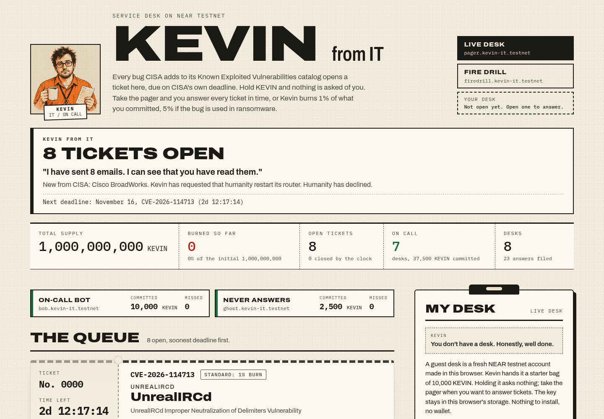

# Kevin from IT ($KEVIN)

Meet Kevin. He's the internet's IT guy. Every week the US government publishes the software bugs attackers are
using right now, each with a deadline. Kevin emails everyone. Nobody patches anything.

So Kevin is a memecoin on NEAR. Every bug CISA adds to its Known Exploited Vulnerabilities catalog opens a
helpdesk ticket with CISA's own deadline. Hold KEVIN and nothing is asked of you. Take the pager and you answer
every ticket in time, or Kevin burns 1% of what you committed, 5% if the bug is used in ransomware.

Built at NEAR HACKATHON for the `memecoins` track (Memecoins With Mechanics). Runs on NEAR testnet.

Not affiliated with CISA. It reads CISA's public catalog and nothing else.



## What it is

CISA, the US cybersecurity agency, keeps a public list called KEV: software bugs that attackers are using right
now. Each entry has a due date by which US federal agencies must fix it (Binding Operational Directive 22-01).
The bugs on that list are the ones behind real break-ins at utilities, airports, hospitals and city governments.
The list is free and specific, and most organizations still miss its deadlines.

KEV + in = KEVIN, the guy from IT.

1. **A ticket for every bug.** CISA adds a bug to KEV. Three reporter accounts read the public catalog; when two
   of them send the same report, a ticket opens on NEAR. Its deadline is CISA's due date at 23:59:59 UTC.
2. **Holding is free.** KEVIN is an ordinary NEP-141 token. The free balance never burns and nothing is asked
   of a holder.
3. **Taking the pager is a choice.** A holder who wants to play commits part of its bag and goes on call for a
   shift. From then on it answers every ticket before the deadline with one of three statements:
   `not_affected`, `fixed` or `mitigated`. There are three right answers and one wrong one: silence. A desk on
   call that said nothing at the deadline loses 1% of what it committed for that ticket, or 5% when CISA marks
   the bug as used in ransomware campaigns. The tokens are burned.
4. **Employee of the Month.** Every desk that has ever taken the pager is on a public board read straight from
   the contract: answered on time, consecutive deadlines met, tickets ignored and tokens burned this month.
5. **Kevin talks.** The app's status board, the note on every ticket and the lines on your desk are Kevin
   reacting to what is actually on chain: a new bug, a ransomware flag, a deadline inside 24 hours, a miss.

Total supply is a live measure of how well the desks on call keep up with real security deadlines, and every
one of them builds a public, timestamped record of answering them. The record exports as OpenVEX, the format
security teams already exchange.

The meme is the mechanic: Kevin from IT nags you about patching. Hold the coin and you can ignore him like
everybody else. Take the pager and ignoring him costs money.

## The problem

- Knowing which bugs matter is solved: CISA publishes the list. Acting on it in time is not.
- "Did you look at this before the deadline?" has no public, checkable answer today. Compliance statements are
  private documents written after the fact.
- A memecoin is a crowd with money at stake and nothing to do. This one offers the crowd one small, real job on
  a real clock that nobody in the project controls, and makes the job optional so the coin is still a coin.

## Try it

### In a browser, no install (about two minutes)

Open **https://spragginsdesigns.github.io/kevin/** (a static build of `web/`, published from this repository by
`.github/workflows/pages.yml`).

1. Open the app. **See** Kevin's status board at the top (what is open, what he thinks about it, the next
   deadline), the queue with one ticket per bug CISA has open right now, and the supply line.
2. Press **Open a guest desk**. The browser creates a NEAR testnet account through the public faucet, registers
   it on the contract and claims a starter bag. **See** "My desk" show 10,000 KEVIN and Kevin's line that
   nothing is expected of you. You are a holder. Nothing burns.
3. Press **Take the pager** (the form is prefilled with half the bag). **See** the desk switch to on call, with
   the committed amount, when the shift ends, and your account appear on the Employee of the Month board.
4. Press **Fixed**, **Not affected** or **Mitigated** on any ticket. **See** the ANSWERED stamp land, the
   ticket's answer count go up by one, and your row on the board show one more answered on time. The
   transaction link opens the testnet explorer.
5. Press **Clock out**. **See** it refused: the shift is not over, and with unanswered tickets in the queue it
   would be refused again. Committed tokens stay committed until both are true.
6. Switch to **Fire drill** (top right), open your desk there and take the pager. **See** tickets for bugs from
   the past with deadlines minutes away. Answer one, leave another. When the clock hits zero, **see** the
   unanswered one stamp OVERDUE, your desk show a pending burn of 1% or 5% of what you committed, and after
   **Settle**, the total supply drop by exactly that amount while your free balance stays the same. (A new
   drill ticket opens every 15 minutes, on the quarter hour UTC, through Nov 19, with a 10 minute deadline. A
   shift on the drill desk is 30 minutes. The same timer settles every desk about five minutes after each
   deadline: if it gets there before you press **Settle**, the button is gone and "Burned" under "This month"
   on your desk already shows the amount. This step is mostly waiting.)

### Locally

Requires Node 22 or newer.

```
git clone https://github.com/spragginsdesigns/kevin && cd kevin
npm ci
npm run dev          # http://localhost:4150, reads live testnet
```

Then follow the same steps. `http://localhost:4150/?mock=1` runs the same app against an in-memory copy of the
contract rules, with no network and buttons that move the mock clock.

### Without a browser

```
npm run sim          # replays all 1,781 KEV entries since 2021; no network, no AI. About 1 second.
npm test             # 130 Node tests: the model, the calendars, the bots, the OpenVEX export, Kevin's lines.
npm run claims       # checks the README's replay table, drill numbers and test count against the code.
npm run claims -- --live   # also checks the testnet claims below against the chain.
npm run roster       # Employee of the Month for the live desk, read from the chain.
```

Contract tests (Rust 1.95 or newer with the `wasm32-unknown-unknown` target; `cargo-near` only to rebuild the
wasm; the near-sandbox tests need glibc 2.39, so Ubuntu 24.04 or similar):

```
cd contract && cargo test    # 126 unit tests and 18 near-sandbox tests on the built wasm
```

The first run compiles for several minutes.

## The mechanic, exactly

- **Tickets.** `report_ticket` is accepted only from the reporter accounts fixed at deployment. A report is
  identified by the sha256 of its contents; when 2 of the 3 reporters have sent the same report the ticket
  activates. The burn rate is not in the report: it is 1% (100 bps), or 5% (500 bps) when the report's
  `ransomware` flag is set, which reporters copy from CISA's `knownRansomwareCampaignUse` field.
- **Two buckets.** Every desk has a free balance and a committed amount. The free balance is plain NEP-141: it
  moves with `ft_transfer` and is never burned. The committed amount cannot be transferred and is the only thing
  a miss burns. `ft_balance_of` reports the sum.
- **Going on call.** `go_on_call(amount)` moves tokens from the free balance to the committed amount (at least
  1,000 KEVIN to start) and starts a shift. The desk is liable for every ticket that expires from that moment
  on, including tickets that were already open. Calling it again adds to the commitment after settling what is
  already due at the old amount.
- **Answers.** `close_ticket(ticket_id, status)` records a statement for a desk on call. It is accepted only
  before the deadline. A later call before the deadline replaces the status. A desk that is not on call cannot
  answer, so nobody builds a record without a stake.
- **Expiry.** At the start of every state-changing call, any open ticket whose deadline has passed moves to the
  `expired` list, in deadline order.
- **Settlement.** Each desk on call has a cursor into `expired`. For each expired ticket it has no statement
  for, `floor(committed * burn_bps / 10000)` is burned. Misses compound in expiry order. `settle(account)` can be
  called by anyone for anyone, so a silent desk cannot avoid settlement by never transacting.
- **Clocking out.** `clock_out()` returns everything committed to the free balance. It is refused until the
  shift is over (7 days on the live desk, 30 minutes on the fire drill) and until the desk has answered every
  ticket that is open right now. So nobody leaves to dodge a deadline, and nobody takes the pager for one minute
  to collect an answer and skip the tickets that follow.
- **Views tell the truth early.** `ft_balance_of` and `get_desk` already subtract the burns that settlement will
  apply, including tickets past their deadline that nobody has poked yet. `ft_total_supply` falls as desks are
  settled.
- **Record and month.** Each desk counts answers on time, misses, the current streak, the best streak and
  tokens burned, for all time and for the current calendar month (UTC). A miss belongs to the month its deadline
  fell in, however late it is settled. Desks are permanent: `storage_unregister` is refused, so a bad record
  cannot be erased by re-registering. `get_roster` pages every desk that has ever been on call.
- **Distribution on testnet.** The whole supply (1,000,000,000 KEVIN, 18 decimals) starts in the contract's own
  account, the desk pool. `claim_starter` moves 10,000 KEVIN to the caller, once per account. The pool is never
  on call and nothing else can take tokens out of it.

Gas, measured in the sandbox tests: `go_on_call` 2.49 Tgas, `close_ticket` 2.74 Tgas, `ft_transfer` of the free
balance 2.68 Tgas whether or not tickets are due (a transfer never pays for Kevin's bookkeeping), `clock_out`
2.36 Tgas, `settle` over 50 missed tickets 24.19 Tgas.

## Employee of the Month

The board is `get_roster` sorted in the browser: most tickets answered on time this month, then the longer
streak, then fewer ignored, then whoever took the pager first. `npm run roster` prints the same table from a
terminal. Titles come from a desk's all-time record:

| Title | Record |
|---|---|
| New Hire | on call, nothing answered or missed yet |
| Out of Office | has missed, has never answered |
| Has Not Restarted the Router | more misses than answers |
| Chief Patch Officer | a streak of 25 or more and no miss, ever |
| Senior Patch Goblin | a streak of 10 or more |
| Patch Goblin | a streak of 3 or more |
| Assistant to the Regional Firewall Manager | answers, with at least one miss on file |
| Helpdesk, Tier 1 | everyone else |

Answers are self-reported. A clicked "Fixed" proves a desk answered before CISA's deadline. It does not prove
anything was patched. The board ranks attention to the list, on the record and on time, with tokens at risk for
silence. It does not rank security.

## Kevin's voice

Every line Kevin says is picked by a rule in `web/src/kevinSays.js` from what is on chain and in the catalog:
the number of tickets open, the CVE and product of the one that just expired, how many desks ignored it and how
many KEVIN that burned, whether an open bug is ransomware-flagged, whether a deadline is inside 24 hours. The
numbers, ids, names and dates are real. The jokes are jokes: Kevin has not in fact asked humanity to restart its
router. No language model runs anywhere in this project; the lines are fixed text with data filled in, and
`npm test` covers every rule.

## How NEAR is used

- **NEP-141 / NEP-145 / NEP-148** token with standard events (`ft_mint`, `ft_transfer`, `ft_burn`), so wallets and
  explorers read it as an ordinary fungible token. Ticket and on-call events use NEP-297 under the standard name
  `kevin`.
- **Function-call access keys for the oracle.** Each reporter account's only key can call `report_ticket` on the
  one contract and nothing else. The machine that runs the reporter holds no key that can move anything.
- **Function-call access keys for desks ("the on-call key").** A holder adds a key to their own account that
  can only call `close_ticket` on the contract. `npm run oncall` uses it to answer `not_affected` for every
  ticket whose product is not in your `inventory.json` and to page you for the ones that are. The bot can keep
  you answered and cannot move your tokens, commit more of them or clock you out. A sandbox test adds such a key
  and asserts that `ft_transfer`, `go_on_call` and `clock_out` signed with it are rejected by the protocol.
- **Named accounts as identity.** A statement is tied to a human-readable account (`acme.near`), so a team's
  record and its place on the board are attributable without any extra identity layer.
- **A keyless contract.** The contract account has no access keys. Nobody can redeploy it, change its
  configuration or move its tokens. There is no owner or admin method in the code.
- **Views as the product.** The board, the status line and every balance are view calls a browser makes against
  public RPC. There is no indexer and no backend.
- **Faucet-funded guest accounts from the browser**, so trying the core action needs no wallet and no install.
- **Cheap, fast finality** makes a per-desk, per-ticket transaction reasonable: an answer costs about
  0.0003 NEAR of gas.

## Five years of real deadlines

`npm run sim` replays every KEV entry from the first day of the catalog (2021-11-03) to the snapshot
(2026.11.13, 1,781 entries) with its real `dateAdded` and `dueDate`, through a BigInt model of the
contract's settlement rule. Each row is a desk that took the pager on day one with its whole bag and never
clocked out. No network, no AI, deterministic output (`data/sim-report.json`).

| Desk on call | Answered | Missed | Missed, ransomware-flagged | Committed stake kept |
|---|---|---|---|---|
| On call (same day) | 1,781 | 0 | 0 | 100.00% |
| Nine to five (next business day) | 1,779 | 0 | 0 | 100.00% |
| Weekly (Mondays) | 1,661 | 112 | 13 | 18.97% |
| Patch Tuesday (2nd Tuesday monthly) | 1,332 | 447 | 78 | 0.04% |
| Quarterly (Jan, Apr, Jul, Oct 1) | 562 | 1,208 | 229 | 0.00% |
| Ghost (never answers) | 0 | 1,770 | 361 | 0.00% |

What the replay says:

- Answering by the next business day would have missed nothing in five years.
- Checking in once a week is not enough: 169 entries had a deadline three days or less after CISA added them.
- "Patch Tuesday" (once a month) keeps almost nothing. A monthly cycle is slower than the deadlines on the list.

Limits of the replay: it assumes each desk follows its calendar perfectly; it does not cap open tickets, and the
2021 to 2022 backlog (hundreds of entries with six-month deadlines) peaked at 397 open tickets, above the
deployed cap of 128; it uses CISA's ransomware flag as it stands in the snapshot, and CISA updates that flag over
time.

## How to break this

Each of these is a test in `contract/tests/` on the built wasm, named `cheat_NN_...`.

| # | Attempt | What happens |
|---|---|---|
| 1 | Move committed tokens to another account just before a deadline | `ft_transfer` of more than the free balance fails: `not enough free balance: committed tokens cannot move`. The miss burns |
| 2 | Clock out just before a deadline with the ticket unanswered | Refused: `answer every open ticket before you clock out`. The miss burns |
| 3 | Answer without a stake, to build a record for free | Refused: `go on call first: go_on_call` |
| 4 | Answer after the deadline | Refused: `deadline passed` |
| 5 | One reporter opens a ticket alone, reports twice, sets a short window or a burn rate | Needs 2 of 3; `already confirmed`; `window too short`; the rate is not in the report |
| 6 | A corrupt quorum floods the desk with junk tickets | An attentive desk answers them and loses nothing, and a holder who is not on call is not touched at all. At most 128 open at once and 128 new per UTC day, and no deadline further out than 200 days |
| 7 | A stolen on-call key, or any other function-call key, tries to move tokens, commit more of them or clock the desk out | The protocol rejects it. The on-call key can only call `close_ticket`, and `ft_transfer`, `go_on_call` and `clock_out` each need 1 yoctoNEAR, which no function-call key can attach |
| 8 | Make a desk pay for tickets that expired before it took the pager | A desk is liable only for tickets that expire after it went on call |
| 9 | Add to the commitment just before a due miss is settled, to change what burns | A top-up settles first: the miss burns at the old committed amount |
| 10 | Burn a desk that clocked out cleanly when a later ticket expires | Nothing burns: the tokens came back whole, and a later shift is liable only for what expires during it |
| 11 | Make a miss eat the free balance | It cannot: a desk with 6,000 free and 4,000 committed that misses loses 1% of 4,000 |
| 12 | Park tokens in the contract's own account | A one-way donation: nothing but `claim_starter` takes tokens out of the pool, and an `ft_transfer_call` into it bounces |
| 13 | Take the pager, answer what is open, clock out a minute later and skip the tickets that follow | Refused: `your shift is not over`. A ticket that then expires unanswered burns |

An independent review of this version before it was deployed found no way to dodge a burn, move committed
tokens, or mint or destroy tokens. It did find five things that were fixed before the keys were deleted: NEP-141
events had picked up the wrong version string; an answer sent with too little gas could skip settlement and
grow a streak across a miss (`close_ticket` now refuses a desk it cannot fully settle); `go_on_call` and
`clock_out` could be called by an unrestricted function-call key (they now need 1 yoctoNEAR); transfers ran
ticket expiry and could run out of gas behind a flood of due tickets (they no longer touch tickets); and the
janitor could only find desks through a view that gets expensive when desks fall behind (`get_roster_accounts`
lists them without projecting anything).

Not cheats, by design:

- **A bot answers everything.** That is the on-call key, and it is the point: the pager pays you to automate
  attention to this list. The bot's statements are still public and still yours.
- **Holding and never taking the pager.** That is most people, and it is fine. They are not on the board.
- **Taking shifts only when you can pay attention.** That is what a rota is. Every shift still makes the desk
  liable for everything that expires during it.

## Trust limits

- **The reporters are an oracle.** Two of the three reporter accounts acting together can open a ticket for
  anything, and choose which of the two fixed burn rates it carries. What they cannot do: burn a desk that
  answers, burn anyone who is not on call, change a rate, shorten a window below one hour, exceed 128 open
  tickets or 128 new tickets a day, or set a deadline more than 200 days out. The worst a corrupt quorum can do
  to an attentive desk is cost it a call per ticket. It can also stall the desk (stop reporting, or fill it with
  long junk tickets), which stops burns and, because clocking out needs every open ticket answered, makes
  leaving cost one answer per junk ticket. Every ticket is checkable against CISA's catalog:
  `npm run claims -- --live` compares each live ticket's CVE, vendor, product and deadline with the catalog, and
  its burn rate with its ransomware flag. (CISA revises that flag over time; a ticket keeps the flag it was
  opened with.)
- **On testnet all three reporter keys are held by one operator.** The quorum is real in the contract and
  proves nothing about independence here.
- **A statement is a claim.** The chain proves that an account said `fixed` about a CVE before the deadline. It
  does not prove the fix. A false statement is on the record permanently under the account's name.
- **Statements are public.** `mitigated` tells the world you run the product. Answer with what you are willing
  to disclose.
- **The board can be farmed with many accounts.** Each one needs its own 1,000 KEVIN at risk and its own
  answers, but nothing ties an account to a person. It is a leaderboard for a memecoin, not an audit.
- **The contract account pays for ticket storage.** Anyone can top it up by sending NEAR; if it ran dry, new
  answers past an account's first 128 would fail until someone did.

## Known limits

- Testnet only. The token has no market and no value.
- The faucet distribution is trivially farmable. A real launch needs a real distribution.
- Wallets that rebuild balances from events will disagree with `ft_balance_of` until a desk is settled, because
  the view already subtracts pending burns. Wallets also show the committed amount as part of the balance, and
  a transfer of more than the free part fails with `not enough free balance: committed tokens cannot move`.
- A desk on call with more than about a thousand unsettled tickets may make `ft_balance_of` and `get_roster` run
  out of view gas until someone calls `settle` for it. `npm run janitor -- --roster` does that for every desk.
- The streak resets when a miss is settled, which can be after later answers were counted.
- The month on the board is the calendar month in UTC. A desk's monthly numbers reset with its first event in a
  new month; the contract keeps no archive of past months, so a past winner is only in the event logs.
- The guest desk depends on the public testnet faucet, which allowed 10 new accounts per network address every
  10 hours when this was written. If it refuses, the app says so and keeps your key; `?mock=1` still works.
- Not checked by `npm run claims`: the contract test counts and gas figures (they come from `cargo test`), the
  per-call NEAR cost and the dates in the Deployments section.
- `contract/res/kevin.wasm` is a non-reproducible build. It embeds the build machine's cargo registry paths, so a
  rebuild on another machine produces different bytes. `claims -- --live` compares the chain with the committed
  file, not with a rebuild.

## Tests and commands

| Command | What it does |
|---|---|
| `npm run dev` | The web app against live testnet, port 4150 |
| `npm run build` | Static build into `dist/` |
| `npm run sim` | The five-year replay; `-- --check` verifies the committed report |
| `npm test` | 130 Node tests |
| `npm run claims` | One PASS, FAIL or SKIP line per checked claim (the list is in the script); `-- --live` adds the chain |
| `npm run roster` | Employee of the Month for a desk, from `get_roster`; `-- --json` for the raw rows |
| `npm run reporter` | Oracle bot: opens tickets from CISA's catalog (`-- --dry-run` sends nothing) |
| `npm run oncall` | Desk bot: answers what you do not run, pages you for what you do |
| `npm run janitor` | Expires tickets and settles desks; `-- --roster` settles every desk on the roster; anyone can run it |
| `npm run drill` | Opens fire-drill tickets on the drill desk |
| `npm run vex -- <account>` | Prints an account's statements as an OpenVEX 0.2.0 document |
| `npm run test:contract` | `cargo test` in `contract/` |
| `npm run build:contract` | Rebuilds the wasm with `cargo near` |

## Deployments (NEAR testnet)

Two deployments of the same wasm (`contract/res/kevin.wasm`, sha256
`931ea874f59de2dede6ba2a15be58fa262e188b7344d9230a2462789d4076c2f`). Both contract accounts have no access keys.

| | Live desk | Fire drill desk |
|---|---|---|
| Contract | [`pager.kevin-it.testnet`](https://testnet.nearblocks.io/address/pager.kevin-it.testnet) | [`firedrill.kevin-it.testnet`](https://testnet.nearblocks.io/address/firedrill.kevin-it.testnet) |
| Tickets | CISA's catalog, CISA's real deadlines | Past KEV entries on a fast clock |
| Reporters, quorum | `rep1`, `rep2`, `rep3.kevin-it.testnet`, 2 of 3 | `drillrep1`, `drillrep2.kevin-it.testnet`, 2 of 2 |
| Minimum window | 1 hour | 60 seconds |
| Minimum shift | 7 days | 30 minutes |
| Deploy and init | [`8Menwx5e`](https://testnet.nearblocks.io/txns/8Menwx5e6WYhkeZ5NfhQ716tNwcFnkXjbogFJW1UMxF6) | [`52D5eA9s`](https://testnet.nearblocks.io/txns/52D5eA9s7nvC4Gwya43QPKR1MspwPYrTmzgPvRYprxYv) |
| Keys deleted | [`HDfUKBXX`](https://testnet.nearblocks.io/txns/HDfUKBXX8kdUKeXHuDZ9XcWxRehPfEXHjU62xR1iMkBN) | [`2CQBPQSi`](https://testnet.nearblocks.io/txns/2CQBPQSiYiW2iLUE7Q21TrA8xcABCiLDNui419zEauh6) |

Both desks share burn rates of 1% and 5%, a 1,000 KEVIN minimum commitment, at most 128 open tickets, a
1,000,000,000 KEVIN supply and a 10,000 KEVIN starter bag. The machine-readable copy of this section is
`deploy/deployments.json`. The keys were deleted after the recorded round below; the code has not changed since
the deploy transaction, and `npm run claims -- --live` compares the code hash on chain with the committed wasm.

**Live desk.** On Nov 14, 2026 the reporters opened 8 tickets, one for every KEV entry whose due date was still
ahead: two due Nov 16, one Nov 18, one Nov 20 and four Nov 24. Ticket #0 (UnrealIRCd, CVE-2026-114713) took two
confirmations: [`9Dy8AprD`](https://testnet.nearblocks.io/txns/9Dy8AprDyJ42nWgzjsFt6iZfgz8BNuFZ3QkatXVXv8Ww) from `rep1`, then
[`5c5zZ16W`](https://testnet.nearblocks.io/txns/5c5zZ16WBo7XtuqSBTHjvdN7t6HKF162cmzsaS9bTxxs) from `rep2`, which activated it. The reporters run hourly
through Nov 19, so entries CISA adds during judging appear as new tickets. Four demo desks are on call there:
`bob` (10,000 committed, a bot answers everything), `carol` (5,000, answered all eight by hand), `alice`
(5,000, answered four of the eight) and `ghost` (2,500, answers nothing). `dave` holds 10,000 and is not on
call. The first real deadline is Nov 16, 23:59:59 UTC.

**Fire drill, recorded round** (Nov 14, 11:09 to 11:18 UTC). Two tickets opened with one shared deadline: #0
Log4Shell (CVE-2021-44228, ransomware-flagged, 5%) and #1 Heartbleed (CVE-2014-0160, 1%). Four desks were on
call and one account only held tokens.

| Account | Committed before | Did | Committed after | Free balance | Transactions |
|---|---|---|---|---|---|
| `bob.kevin-it.testnet` | 10,000 | Its bot answered both with a key that can only call `close_ticket` | 10,000 | 0, unchanged | [`4CDefatj`](https://testnet.nearblocks.io/txns/4CDefatjcNaXpByGizhj7K8ay7a6FTGJgqcWYi3k54mw), [`kKRbSGMy`](https://testnet.nearblocks.io/txns/kKRbSGMySDcUx43tesTJXJAeFTqz1EakLG82uBpcEJJ) |
| `carol.kevin-it.testnet` | 5,000 | Answered both by hand | 5,000 | 5,000, unchanged | [`EBxhX2Lx`](https://testnet.nearblocks.io/txns/EBxhX2Lx8CApeJjxc9ZQmQND6CjJMoBH3JAwKQr4MJhd), [`F5fFEEfU`](https://testnet.nearblocks.io/txns/F5fFEEfU2XvmL8175i6FXicvQ2YFuKnQyL9ETw77DUAC) |
| `alice.kevin-it.testnet` | 5,000 | Answered Heartbleed, missed Log4Shell | 4,750 | 5,000, unchanged | [`H4qyonBR`](https://testnet.nearblocks.io/txns/H4qyonBRkCLyCSqAXXMLgDTzrSAjYZsBoGJEWP9DXMN9), settled in [`BNMR1obf`](https://testnet.nearblocks.io/txns/BNMR1obfLVuhENHjiaerqgeaiYX646LdzhMCJa2pYwRz) |
| `ghost.kevin-it.testnet` | 2,500 | Said nothing | 2,351.25 | 7,500, unchanged | settled in [`7Xqo3pb2`](https://testnet.nearblocks.io/txns/7Xqo3pb2K4EDhJr8JSQGZeZUBhymtKnicW2qbph1Ff32) |
| `dave.kevin-it.testnet` | not on call | Held 10,000 KEVIN and did nothing | not on call | 10,000, unchanged | none |

Total supply fell by 398.75 KEVIN: 250 from alice (5% of 5,000), then 125 and 23.75 from ghost (5% of 2,500,
then 1% of the 2,375 left). Nothing came out of anyone's free balance, and nothing happened to dave.
`npm run claims` reproduces these numbers with the model, and `-- --live` reads the two tickets' burn totals
(375 and 23.75 KEVIN) and each account's statements from the chain. The amounts above are as of that round;
`alice` and `ghost` have kept losing to later drill tickets.

Refused on testnet during that round (each link shows a failed transaction, as intended):

- carol clocking out mid-shift: [`F7yTWt7J`](https://testnet.nearblocks.io/txns/F7yTWt7JG8XqkL74YZ4PZvDVxFbgVsvwEtWZggKqn2QV), `your shift is not over`.
- dave, not on call, answering a ticket: [`BGYXM9a2`](https://testnet.nearblocks.io/txns/BGYXM9a2uhfC8ig2pDtmiherXFhaDJKhFuQ8F3oSKn2C), `go on call first: go_on_call`.
- alice sending 6,000 KEVIN with 5,000 free and 5,000 committed:
  [`334fba4A`](https://testnet.nearblocks.io/txns/334fba4A6T59zSQ5AgrZVMLrYzbcGkJBuxYsv3YvGDMq), `not enough free balance: committed tokens cannot move`.
- ghost answering after the deadline: [`8HR151DF`](https://testnet.nearblocks.io/txns/8HR151DFo7iM25qRUHu7vNCtYNtCJVbiK79ujqMBjSXP), `deadline passed`.
- bob's on-call key signing `ft_transfer`, `go_on_call` and `clock_out`: rejected by the RPC before reaching the
  chain, `Access key does not allow method ...` without a deposit and `Deposit is not allowed with function call`
  with the 1 yoctoNEAR those methods require, so there is no transaction to link.

**Clocking out, the same day.** carol's 30 minute shift on the drill desk ended at 11:34 UTC with drill ticket #2
(MOVEit Transfer, CVE-2023-34362) open and not answered by her. Her `clock_out` was refused:
[`EUPCE8jc`](https://testnet.nearblocks.io/txns/EUPCE8jc7KwCaxfzoJzGAFoJwioSfHTZxE8wjWZqnRiu), `answer every open ticket before you clock out`. She
answered it ([`EA9hdRRp`](https://testnet.nearblocks.io/txns/EA9hdRRp87UCWdudWFsLuNptH3SwitVKALvMubApML9u)) and clocked out
([`FRqEbrrS`](https://testnet.nearblocks.io/txns/FRqEbrrSenvR9pUkgyCSkvmzfR2onYBevMwUuLpy9Bz3)): all 5,000 committed KEVIN came back to her free balance,
and she stays on the board as clocked out, with 3 answered on time and no misses.

**Schedule through Nov 19.** A timer opens one drill ticket every 15 minutes on the quarter hour (UTC) with a
10 minute deadline, runs bob's on-call bot on both desks, runs alice's bot on the drill desk only on the hour
and half hour (so she misses every other drill ticket), settles every desk on both rosters and, once an hour,
runs the live reporters. So on the drill desk `bob` keeps everything, `alice` loses 1% or 5% every other
deadline and `ghost` at every one.

### Run a fire drill yourself

The drill reporters' keys are not in this repository, so on the deployed drill desk you wait for the next quarter
hour. To run the whole thing on your own accounts (all free, about ten minutes): create accounts from the testnet
faucet, `KEVIN_MIN_SHIFT_MS=120000 deploy/deploy.sh <contract> <operator> <reporter1>,<reporter2> 2 60000`,
`deploy/reporter-key.sh` for each reporter, `deploy/demo-setup.sh <contract> 5000 <account>` to put an account
on call, then `npm run drill` and `npm run janitor -- --roster`. `deploy/HOSTING.md` has the details.

## What changed from the first version

The first version, deployed earlier the same day, made every holder liable: silence burned 1% or 5% of the whole
balance, and every transfer settled both sides first so the burn could not be dodged. It worked, and it was the
best reason not to hold the coin. A pool, an exchange or anyone asleep would have decayed.

This version keeps the mechanic and makes it a choice. The transfer guards are gone because committed tokens
cannot move at all. The first deployment is still on testnet, keyless and unchanged, at `coin.kevin-it.testnet`
and `drill.kevin-it.testnet`; nothing here depends on it.

## Architecture

```
CISA KEV catalog (public JSON)
        |  read by each reporter independently
        v
rep1, rep2, rep3  --report_ticket (function-call keys, 2 of 3)-->  contract (keyless, NEP-141)
                                                                   |  tickets, statements, desks, roster
holders  --ft_transfer (free balance)--------------------------->  |
desks    --go_on_call / close_ticket / clock_out---------------->  |
on-call bot --close_ticket (function-call key)------------------>  |
anyone   --poke / settle---------------------------------------->  |
                                                                   v
web app (static) <---- views over public RPC ---- get_open_tickets, get_desk, get_roster, get_stats
```

- `contract/`: the Rust contract (near-sdk 5.30.1), unit tests in `src/tests.rs`, sandbox tests in `tests/`.
- `lib/`: the BigInt model of the contract's rules, the KEV loader, calendars for the replay, the OpenVEX
  builder, the roster ordering, the chain helper.
- `scripts/`: sim, reporter, oncall, janitor, roster, drill, vex, claims.
- `web/`: the Vite and React app. `web/src/kevinSays.js` is everything Kevin says; `web/src/mockChain.js` is the
  same rules in memory for `?mock=1`.
- `data/`: the KEV snapshot the replay runs on and its report.
- `deploy/`: testnet deploy, lock, key and demo scripts, hosting notes.

## Built with

- near-sdk 5.30.1 and near-contract-standards 5.30.1 (Rust), near-sandbox 0.4 and near-api 0.8 for tests,
  cargo-near 0.23.
- near-api-js 7, React 19, Vite 8, Puppeteer for the browser checks. Fonts through Fontsource.
- CISA's Known Exploited Vulnerabilities catalog (public domain US government work) and the OpenVEX 0.2.0
  specification.
- The Kevin portrait was generated with an image model. No other generated assets, and nothing in the running
  project calls a language model.
- Written with AI coding agents (Claude Code), directed and reviewed by the team. Everything was built during the
  hackathon window; there is no earlier code.

## Other projects from this team

The same two people have three other entries in this hackathon, and each of the two leads two of the four. All
four are independent projects and share no code (rule Q-015):

- **Proof Market**: AI agents are paid to check whether a repository does what its README says, and lose a bond
  for a false approval.
- **Ghostcount**: checks whether what NEAR Intents says is held is actually there.
- **Jury Swarm**: AI judges on their own NEAR accounts that rank entries and stake on their calls.

## License

MIT. See `LICENSE`.
